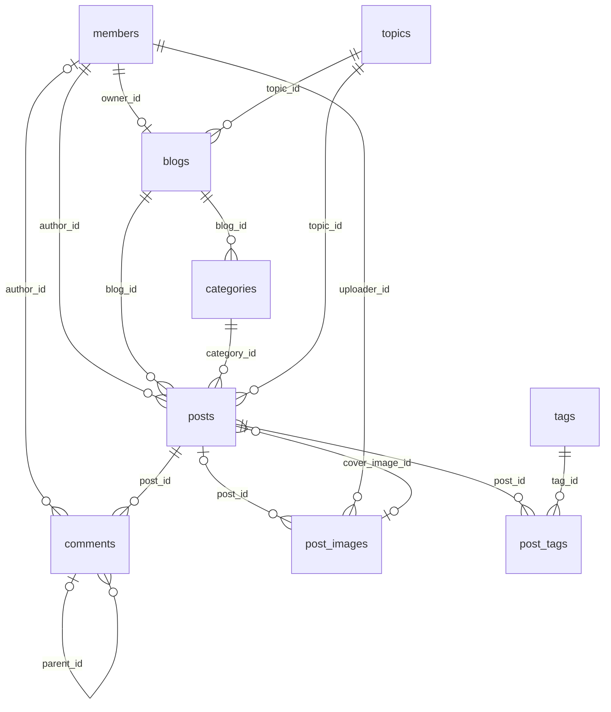
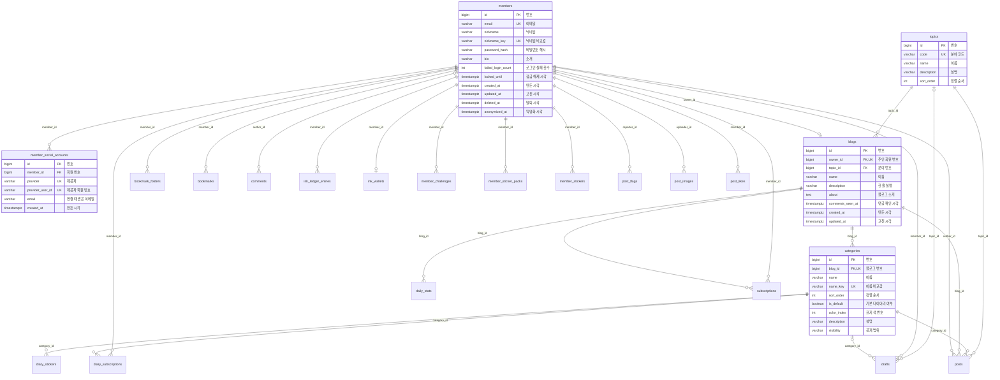
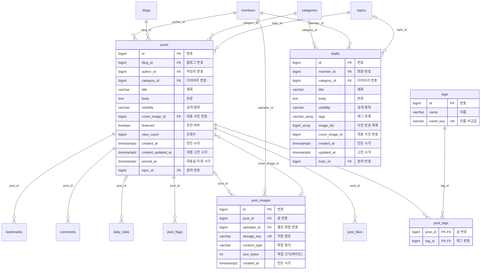
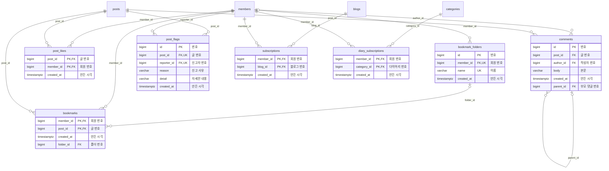
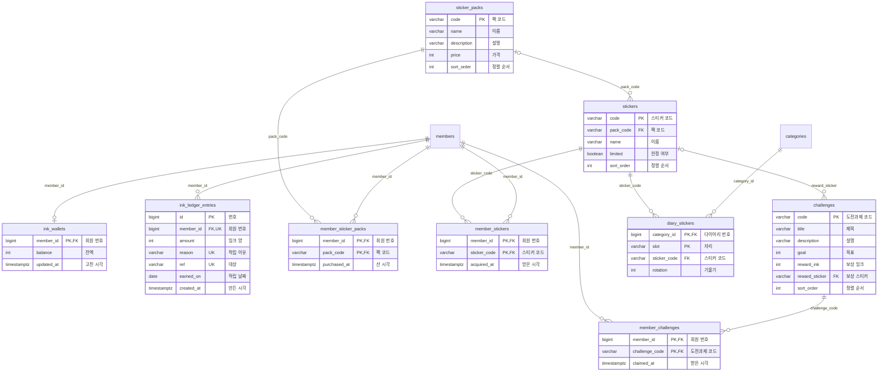
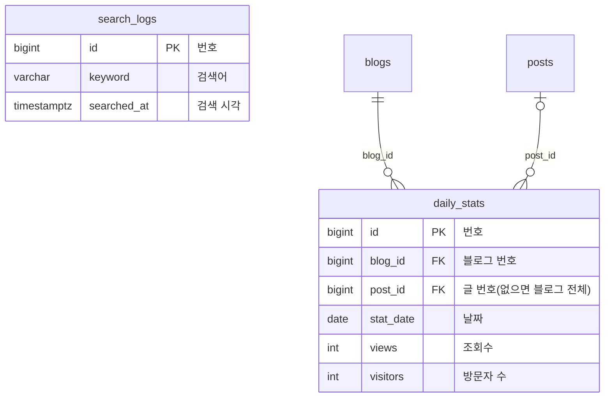

# ERD (데이터베이스 구조)

> 지금 코드(Flyway 마이그레이션 V1~V21)로 만든 PostgreSQL 스키마를 그대로 뽑아 그렸어요. 표 28개, 외래 키 45개예요.
> 마이그레이션 파일이 바뀌면 이 문서도 다시 만들어요. 원본은 `backend/src/main/resources/db/migration/`이에요.
> 같은 구조를 Crowfoot에서도 볼 수 있어요: [사각 (V20, 2026-10-13)](https://crowfoot.java21.net/workspaces/47/models/681). 이 링크는 V20 기준이라 V21의 `member_social_accounts`는 이 문서에서 봐요.

## 읽는 법

- 그림의 선은 외래 키예요. `||--o{`는 "하나에 여러 개", `||--o|`는 "하나에 많아야 하나", 선 왼쪽 `|o`는 비어 있을 수 있는 외래 키예요.
- 그림에는 다른 묶음의 표도 이름만 나와요. 그 표의 칸은 해당 묶음에서 봐요.
- `PK`는 기본 키, `FK`는 외래 키, `UK`는 겹칠 수 없는 칸이에요.
- 각 표가 기능에서 어떻게 쓰이는지는 [기능 설명](../기능/00-목차.md)과 [동작 원리](../원리/00-목차.md)에 있어요.

## 한눈에 (핵심 표만)

## 표 목록

| 묶음 | 표 | 한글 이름 | 무엇 |
|---|---|---|---|
| 회원과 블로그 | [`members`](#members) | 회원 | 회원. 이메일, 비밀번호 해시, 닉네임, 로그인 실패 횟수와 잠금, 탈퇴·익명화 시각 |
| 회원과 블로그 | [`member_social_accounts`](#member_social_accounts) | 소셜 계정 연결 | 카카오 · 구글 계정과 회원의 연결. 소셜 계정 하나는 회원 한 명에게만 |
| 회원과 블로그 | [`blogs`](#blogs) | 블로그 | 블로그. 회원마다 하나(owner_id UNIQUE) |
| 회원과 블로그 | [`categories`](#categories) | 다이어리 | 다이어리. 블로그 안에서 글을 나눠 담는 칸, 공개 범위를 가짐 |
| 회원과 블로그 | [`topics`](#topics) | 분야 | 분야(9개). 블로그와 글이 하나씩 고름 |
| 글 | [`posts`](#posts) | 글 | 글 |
| 글 | [`post_images`](#post_images) | 글 사진 | 올린 사진. 파일은 디스크에 있고 여기는 이름표와 형식만 |
| 글 | [`tags`](#tags) | 태그 | 태그 이름(소문자로 맞춘 name_key로 겹침 막기) |
| 글 | [`post_tags`](#post_tags) | 글 태그 | 글과 태그를 잇는 표 |
| 글 | [`drafts`](#drafts) | 임시저장 글 | 임시저장 글 |
| 읽기와 소통 | [`comments`](#comments) | 댓글 | 댓글과 답글(parent_id가 있으면 답글) |
| 읽기와 소통 | [`post_likes`](#post_likes) | 좋아요 | 좋아요. 한 사람이 한 글에 한 번 |
| 읽기와 소통 | [`bookmark_folders`](#bookmark_folders) | 책갈피 폴더 | 책갈피 폴더 |
| 읽기와 소통 | [`bookmarks`](#bookmarks) | 책갈피 | 책갈피. 폴더가 없으면 미분류 |
| 읽기와 소통 | [`post_flags`](#post_flags) | 신고 | 신고. 한 사람이 한 글에 한 번 |
| 읽기와 소통 | [`subscriptions`](#subscriptions) | 블로그 구독 | 블로그 구독 |
| 읽기와 소통 | [`diary_subscriptions`](#diary_subscriptions) | 다이어리 구독 | 다이어리 구독 |
| 잉크와 스티커 | [`ink_wallets`](#ink_wallets) | 잉크 지갑 | 회원마다 잉크 잔액 |
| 잉크와 스티커 | [`ink_ledger_entries`](#ink_ledger_entries) | 잉크 내역 | 잉크가 들어오고 나간 내역. (회원, 이유, 대상)이 같으면 두 번 주지 않음 |
| 잉크와 스티커 | [`sticker_packs`](#sticker_packs) | 스티커 팩 | 스티커 팩(상점 상품) |
| 잉크와 스티커 | [`stickers`](#stickers) | 스티커 | 스티커 하나하나 |
| 잉크와 스티커 | [`member_sticker_packs`](#member_sticker_packs) | 회원 보유 팩 | 회원이 산 팩 |
| 잉크와 스티커 | [`member_stickers`](#member_stickers) | 회원 보유 스티커 | 회원이 가진 스티커 |
| 잉크와 스티커 | [`challenges`](#challenges) | 도전과제 | 도전과제와 보상 스티커 |
| 잉크와 스티커 | [`member_challenges`](#member_challenges) | 회원 달성 도전과제 | 회원이 달성한 도전과제 |
| 잉크와 스티커 | [`diary_stickers`](#diary_stickers) | 다이어리 표지 스티커 | 다이어리 표지에 붙인 스티커(자리마다 하나) |
| 통계와 검색 | [`daily_stats`](#daily_stats) | 일별 통계 | 날짜별 조회수·방문자 집계 |
| 통계와 검색 | [`search_logs`](#search_logs) | 검색 기록 | 검색 기록(인기 검색어 계산용) |

## 회원과 블로그

가입하면 블로그 하나와 기본 다이어리 "일기장"이 생겨요. 다이어리(categories)마다 공개 범위가 있어요. 카카오 · 구글로 로그인하면 그 계정이 `member_social_accounts`로 회원에 연결돼요(V21).

### members

한글 이름: **회원**

회원. 이메일, 비밀번호 해시, 닉네임, 로그인 실패 횟수와 잠금, 탈퇴·익명화 시각

| 칸 | 한글 이름 | 형식 | 비어도 됨 | 기본값 | 키 |
|---|---|---|---|---|---|
| `id` | 번호 | bigint |  |  | PK |
| `email` | 이메일 | character varying(254) |  |  |  |
| `nickname` | 닉네임 | character varying(10) |  |  |  |
| `nickname_key` | 닉네임 비교값 | character varying(10) |  |  |  |
| `password_hash` | 비밀번호 해시 | character varying(72) |  |  |  |
| `bio` | 소개 | character varying(100) |  | `''::character varying` |  |
| `failed_login_count` | 로그인 실패 횟수 | integer |  | `0` |  |
| `locked_until` | 잠금 해제 시각 | timestamp with time zone | 예 |  |  |
| `created_at` | 만든 시각 | timestamp with time zone |  |  |  |
| `updated_at` | 고친 시각 | timestamp with time zone |  |  |  |
| `deleted_at` | 탈퇴 시각 | timestamp with time zone | 예 |  |  |
| `anonymized_at` | 익명화 시각 | timestamp with time zone | 예 |  |  |

겹치면 안 되는 조합: (`email`), (`nickname_key`)

### member_social_accounts

한글 이름: **소셜 계정 연결**

카카오 · 구글 계정과 회원의 연결. 소셜 계정 하나는 회원 한 명에게만 묶여요. 탈퇴 회원을 익명화할 때 연결도 지워서, 그 뒤에는 같은 소셜 계정으로 새로 가입할 수 있어요.

| 칸 | 한글 이름 | 형식 | 비어도 됨 | 기본값 | 키 |
|---|---|---|---|---|---|
| `id` | 번호 | bigint |  |  | PK |
| `member_id` | 회원 번호 | bigint |  |  | FK → `members.id` (같이 지움) |
| `provider` | 제공자 | character varying(20) |  |  |  |
| `provider_user_id` | 제공자 회원 번호 | character varying(255) |  |  |  |
| `email` | 연결 때 받은 이메일 | character varying(254) | 예 |  |  |
| `created_at` | 만든 시각 | timestamp with time zone |  |  |  |

겹치면 안 되는 조합: (`provider`, `provider_user_id`)

`provider`는 `KAKAO`나 `GOOGLE`만 들어가요(CHECK 제약). `email`은 기록용이고, 로그인은 (`provider`, `provider_user_id`)로 찾아요. `member_id`에 색인이 있어요.

### blogs

한글 이름: **블로그**

블로그. 회원마다 하나(owner_id UNIQUE)

| 칸 | 한글 이름 | 형식 | 비어도 됨 | 기본값 | 키 |
|---|---|---|---|---|---|
| `id` | 번호 | bigint |  |  | PK |
| `owner_id` | 주인 회원 번호 | bigint |  |  | FK → `members.id` (같이 지움) |
| `topic_id` | 분야 번호 | bigint |  |  | FK → `topics.id` (지우기 막음) |
| `name` | 이름 | character varying(30) |  |  |  |
| `description` | 한 줄 설명 | character varying(200) |  | `''::character varying` |  |
| `about` | 블로그 소개 | text |  | `''::text` |  |
| `comments_seen_at` | 댓글 확인 시각 | timestamp with time zone |  |  |  |
| `created_at` | 만든 시각 | timestamp with time zone |  |  |  |
| `updated_at` | 고친 시각 | timestamp with time zone |  |  |  |

겹치면 안 되는 조합: (`owner_id`)

### categories

한글 이름: **다이어리**

다이어리. 블로그 안에서 글을 나눠 담는 칸, 공개 범위를 가짐

| 칸 | 한글 이름 | 형식 | 비어도 됨 | 기본값 | 키 |
|---|---|---|---|---|---|
| `id` | 번호 | bigint |  |  | PK |
| `blog_id` | 블로그 번호 | bigint |  |  | FK → `blogs.id` (같이 지움) |
| `name` | 이름 | character varying(20) |  |  |  |
| `name_key` | 이름 비교값 | character varying(20) |  |  |  |
| `sort_order` | 정렬 순서 | integer |  |  |  |
| `is_default` | 기본 다이어리 여부 | boolean |  | `false` |  |
| `color_index` | 표지 색 번호 | integer |  |  |  |
| `description` | 설명 | character varying(100) |  | `''::character varying` |  |
| `visibility` | 공개 범위 | character varying(12) |  | `'PUBLIC'::character varying` |  |

겹치면 안 되는 조합: (`blog_id`, `name_key`)

### topics

한글 이름: **분야**

분야(9개). 블로그와 글이 하나씩 고름

| 칸 | 한글 이름 | 형식 | 비어도 됨 | 기본값 | 키 |
|---|---|---|---|---|---|
| `id` | 번호 | bigint |  |  | PK |
| `code` | 분야 코드 | character varying(20) |  |  |  |
| `name` | 이름 | character varying(20) |  |  |  |
| `description` | 설명 | character varying(100) |  |  |  |
| `sort_order` | 정렬 순서 | integer |  |  |  |

겹치면 안 되는 조합: (`code`)

## 글

글은 블로그와 다이어리에 속하고, 분야와 태그를 가져요. 사진은 따로 저장하고 글과 이어요.

### posts

한글 이름: **글**

글

| 칸 | 한글 이름 | 형식 | 비어도 됨 | 기본값 | 키 |
|---|---|---|---|---|---|
| `id` | 번호 | bigint |  |  | PK |
| `blog_id` | 블로그 번호 | bigint |  |  | FK → `blogs.id` (같이 지움) |
| `author_id` | 작성자 번호 | bigint |  |  | FK → `members.id` (지우기 막음) |
| `category_id` | 다이어리 번호 | bigint |  |  | FK → `categories.id` (지우기 막음) |
| `title` | 제목 | character varying(100) |  |  |  |
| `body` | 본문 | text |  |  |  |
| `visibility` | 공개 범위 | character varying(12) |  | `'PUBLIC'::character varying` |  |
| `cover_image_id` | 대표 사진 번호 | bigint | 예 |  | FK → `post_images.id` (비움) |
| `featured` | 추천 여부 | boolean |  | `false` |  |
| `view_count` | 조회수 | bigint |  | `0` |  |
| `created_at` | 만든 시각 | timestamp with time zone |  |  |  |
| `content_updated_at` | 내용 고친 시각 | timestamp with time zone | 예 |  |  |
| `pinned_at` | 대표글 지정 시각 | timestamp with time zone | 예 |  |  |
| `topic_id` | 분야 번호 | bigint |  |  | FK → `topics.id` (지우기 막음) |

### post_images

한글 이름: **글 사진**

올린 사진. 파일은 디스크에 있고 여기는 이름표와 형식만

| 칸 | 한글 이름 | 형식 | 비어도 됨 | 기본값 | 키 |
|---|---|---|---|---|---|
| `id` | 번호 | bigint |  |  | PK |
| `post_id` | 글 번호 | bigint | 예 |  | FK → `posts.id` (같이 지움) |
| `uploader_id` | 올린 회원 번호 | bigint |  |  | FK → `members.id` (같이 지움) |
| `storage_key` | 저장 경로 | character varying(200) |  |  |  |
| `content_type` | 파일 형식 | character varying(20) |  |  |  |
| `size_bytes` | 파일 크기(바이트) | integer |  |  |  |
| `created_at` | 만든 시각 | timestamp with time zone |  |  |  |

겹치면 안 되는 조합: (`storage_key`)

### tags

한글 이름: **태그**

태그 이름(소문자로 맞춘 name_key로 겹침 막기)

| 칸 | 한글 이름 | 형식 | 비어도 됨 | 기본값 | 키 |
|---|---|---|---|---|---|
| `id` | 번호 | bigint |  |  | PK |
| `name` | 이름 | character varying(15) |  |  |  |
| `name_key` | 이름 비교값 | character varying(15) |  |  |  |

겹치면 안 되는 조합: (`name_key`)

### post_tags

한글 이름: **글 태그**

글과 태그를 잇는 표

| 칸 | 한글 이름 | 형식 | 비어도 됨 | 기본값 | 키 |
|---|---|---|---|---|---|
| `post_id` | 글 번호 | bigint |  |  | PK, FK → `posts.id` (같이 지움) |
| `tag_id` | 태그 번호 | bigint |  |  | PK, FK → `tags.id` (지우기 막음) |

기본 키가 (post_id, tag_id) 조합이라 같은 짝은 한 번만 들어가요.

### drafts

한글 이름: **임시저장 글**

임시저장 글

| 칸 | 한글 이름 | 형식 | 비어도 됨 | 기본값 | 키 |
|---|---|---|---|---|---|
| `id` | 번호 | bigint |  |  | PK |
| `member_id` | 회원 번호 | bigint |  |  | FK → `members.id` (같이 지움) |
| `category_id` | 다이어리 번호 | bigint | 예 |  | FK → `categories.id` (비움) |
| `title` | 제목 | character varying(100) |  | `''::character varying` |  |
| `body` | 본문 | text |  | `''::text` |  |
| `visibility` | 공개 범위 | character varying(12) |  | `'PUBLIC'::character varying` |  |
| `tags` | 태그 목록 | varchar[] |  | `'{}'::character varying[]` |  |
| `image_ids` | 사진 번호 목록 | bigint[] |  | `'{}'::bigint[]` |  |
| `cover_image_id` | 대표 사진 번호 | bigint | 예 |  |  |
| `created_at` | 만든 시각 | timestamp with time zone |  |  |  |
| `updated_at` | 고친 시각 | timestamp with time zone |  |  |  |
| `topic_id` | 분야 번호 | bigint | 예 |  | FK → `topics.id` (비움) |

## 읽기와 소통

댓글, 좋아요, 책갈피, 신고, 구독은 모두 "회원 하나와 글(또는 블로그·다이어리) 하나"를 잇는 표예요.

### comments

한글 이름: **댓글**

댓글과 답글(parent_id가 있으면 답글)

| 칸 | 한글 이름 | 형식 | 비어도 됨 | 기본값 | 키 |
|---|---|---|---|---|---|
| `id` | 번호 | bigint |  |  | PK |
| `post_id` | 글 번호 | bigint |  |  | FK → `posts.id` (같이 지움) |
| `author_id` | 작성자 번호 | bigint | 예 |  | FK → `members.id` (비움) |
| `body` | 본문 | character varying(500) |  |  |  |
| `created_at` | 만든 시각 | timestamp with time zone |  |  |  |
| `parent_id` | 부모 댓글 번호 | bigint | 예 |  | FK → `comments.id` (같이 지움) |

### post_likes

한글 이름: **좋아요**

좋아요. 한 사람이 한 글에 한 번

| 칸 | 한글 이름 | 형식 | 비어도 됨 | 기본값 | 키 |
|---|---|---|---|---|---|
| `post_id` | 글 번호 | bigint |  |  | PK, FK → `posts.id` (같이 지움) |
| `member_id` | 회원 번호 | bigint |  |  | PK, FK → `members.id` (같이 지움) |
| `created_at` | 만든 시각 | timestamp with time zone |  |  |  |

기본 키가 (post_id, member_id) 조합이라 같은 짝은 한 번만 들어가요.

### bookmark_folders

한글 이름: **책갈피 폴더**

책갈피 폴더

| 칸 | 한글 이름 | 형식 | 비어도 됨 | 기본값 | 키 |
|---|---|---|---|---|---|
| `id` | 번호 | bigint |  |  | PK |
| `member_id` | 회원 번호 | bigint |  |  | FK → `members.id` (같이 지움) |
| `name` | 이름 | character varying(20) |  |  |  |
| `created_at` | 만든 시각 | timestamp with time zone |  |  |  |

겹치면 안 되는 조합: (`member_id`, `name`)

### bookmarks

한글 이름: **책갈피**

책갈피. 폴더가 없으면 미분류

| 칸 | 한글 이름 | 형식 | 비어도 됨 | 기본값 | 키 |
|---|---|---|---|---|---|
| `member_id` | 회원 번호 | bigint |  |  | PK, FK → `members.id` (같이 지움) |
| `post_id` | 글 번호 | bigint |  |  | PK, FK → `posts.id` (같이 지움) |
| `created_at` | 만든 시각 | timestamp with time zone |  |  |  |
| `folder_id` | 폴더 번호 | bigint | 예 |  | FK → `bookmark_folders.id` (비움) |

기본 키가 (member_id, post_id) 조합이라 같은 짝은 한 번만 들어가요.

### post_flags

한글 이름: **신고**

신고. 한 사람이 한 글에 한 번

| 칸 | 한글 이름 | 형식 | 비어도 됨 | 기본값 | 키 |
|---|---|---|---|---|---|
| `id` | 번호 | bigint |  |  | PK |
| `post_id` | 글 번호 | bigint |  |  | FK → `posts.id` (같이 지움) |
| `reporter_id` | 신고자 번호 | bigint |  |  | FK → `members.id` (같이 지움) |
| `reason` | 신고 사유 | character varying(20) |  |  |  |
| `detail` | 자세한 내용 | character varying(200) |  | `''::character varying` |  |
| `created_at` | 만든 시각 | timestamp with time zone |  |  |  |

겹치면 안 되는 조합: (`post_id`, `reporter_id`)

### subscriptions

한글 이름: **블로그 구독**

블로그 구독

| 칸 | 한글 이름 | 형식 | 비어도 됨 | 기본값 | 키 |
|---|---|---|---|---|---|
| `member_id` | 회원 번호 | bigint |  |  | PK, FK → `members.id` (같이 지움) |
| `blog_id` | 블로그 번호 | bigint |  |  | PK, FK → `blogs.id` (같이 지움) |
| `created_at` | 만든 시각 | timestamp with time zone |  |  |  |

기본 키가 (member_id, blog_id) 조합이라 같은 짝은 한 번만 들어가요.

### diary_subscriptions

한글 이름: **다이어리 구독**

다이어리 구독

| 칸 | 한글 이름 | 형식 | 비어도 됨 | 기본값 | 키 |
|---|---|---|---|---|---|
| `member_id` | 회원 번호 | bigint |  |  | PK, FK → `members.id` (같이 지움) |
| `category_id` | 다이어리 번호 | bigint |  |  | PK, FK → `categories.id` (같이 지움) |
| `created_at` | 만든 시각 | timestamp with time zone |  |  |  |

기본 키가 (member_id, category_id) 조합이라 같은 짝은 한 번만 들어가요.

## 잉크와 스티커

잉크는 지갑(잔액)과 내역 두 표로 관리해요. 스티커는 팩, 스티커, 회원이 가진 것, 다이어리에 붙인 것으로 나뉘어요.

### ink_wallets

한글 이름: **잉크 지갑**

회원마다 잉크 잔액

| 칸 | 한글 이름 | 형식 | 비어도 됨 | 기본값 | 키 |
|---|---|---|---|---|---|
| `member_id` | 회원 번호 | bigint |  |  | PK, FK → `members.id` (같이 지움) |
| `balance` | 잔액 | integer |  | `0` |  |
| `updated_at` | 고친 시각 | timestamp with time zone |  |  |  |

### ink_ledger_entries

한글 이름: **잉크 내역**

잉크가 들어오고 나간 내역. (회원, 이유, 대상)이 같으면 두 번 주지 않음

| 칸 | 한글 이름 | 형식 | 비어도 됨 | 기본값 | 키 |
|---|---|---|---|---|---|
| `id` | 번호 | bigint |  |  | PK |
| `member_id` | 회원 번호 | bigint |  |  | FK → `members.id` (같이 지움) |
| `amount` | 잉크 양 | integer |  |  |  |
| `reason` | 적립 이유 | character varying(20) |  |  |  |
| `ref` | 대상 | character varying(60) |  |  |  |
| `earned_on` | 적립 날짜 | date |  |  |  |
| `created_at` | 만든 시각 | timestamp with time zone |  |  |  |

겹치면 안 되는 조합: (`member_id`, `reason`, `ref`)

### sticker_packs

한글 이름: **스티커 팩**

스티커 팩(상점 상품)

| 칸 | 한글 이름 | 형식 | 비어도 됨 | 기본값 | 키 |
|---|---|---|---|---|---|
| `code` | 팩 코드 | character varying(30) |  |  | PK |
| `name` | 이름 | character varying(20) |  |  |  |
| `description` | 설명 | character varying(100) |  |  |  |
| `price` | 가격 | integer |  |  |  |
| `sort_order` | 정렬 순서 | integer |  |  |  |

### stickers

한글 이름: **스티커**

스티커 하나하나

| 칸 | 한글 이름 | 형식 | 비어도 됨 | 기본값 | 키 |
|---|---|---|---|---|---|
| `code` | 스티커 코드 | character varying(30) |  |  | PK |
| `pack_code` | 팩 코드 | character varying(30) | 예 |  | FK → `sticker_packs.code` (지우기 막음) |
| `name` | 이름 | character varying(20) |  |  |  |
| `limited` | 한정 여부 | boolean |  | `false` |  |
| `sort_order` | 정렬 순서 | integer |  |  |  |

### member_sticker_packs

한글 이름: **회원 보유 팩**

회원이 산 팩

| 칸 | 한글 이름 | 형식 | 비어도 됨 | 기본값 | 키 |
|---|---|---|---|---|---|
| `member_id` | 회원 번호 | bigint |  |  | PK, FK → `members.id` (같이 지움) |
| `pack_code` | 팩 코드 | character varying(30) |  |  | PK, FK → `sticker_packs.code` (지우기 막음) |
| `purchased_at` | 산 시각 | timestamp with time zone |  |  |  |

기본 키가 (member_id, pack_code) 조합이라 같은 짝은 한 번만 들어가요.

### member_stickers

한글 이름: **회원 보유 스티커**

회원이 가진 스티커

| 칸 | 한글 이름 | 형식 | 비어도 됨 | 기본값 | 키 |
|---|---|---|---|---|---|
| `member_id` | 회원 번호 | bigint |  |  | PK, FK → `members.id` (같이 지움) |
| `sticker_code` | 스티커 코드 | character varying(30) |  |  | PK, FK → `stickers.code` (지우기 막음) |
| `acquired_at` | 얻은 시각 | timestamp with time zone |  |  |  |

기본 키가 (member_id, sticker_code) 조합이라 같은 짝은 한 번만 들어가요.

### challenges

한글 이름: **도전과제**

도전과제와 보상 스티커

| 칸 | 한글 이름 | 형식 | 비어도 됨 | 기본값 | 키 |
|---|---|---|---|---|---|
| `code` | 도전과제 코드 | character varying(30) |  |  | PK |
| `title` | 제목 | character varying(30) |  |  |  |
| `description` | 설명 | character varying(100) |  |  |  |
| `goal` | 목표 | integer |  |  |  |
| `reward_ink` | 보상 잉크 | integer |  |  |  |
| `reward_sticker` | 보상 스티커 | character varying(30) | 예 |  | FK → `stickers.code` (지우기 막음) |
| `sort_order` | 정렬 순서 | integer |  |  |  |

### member_challenges

한글 이름: **회원 달성 도전과제**

회원이 달성한 도전과제

| 칸 | 한글 이름 | 형식 | 비어도 됨 | 기본값 | 키 |
|---|---|---|---|---|---|
| `member_id` | 회원 번호 | bigint |  |  | PK, FK → `members.id` (같이 지움) |
| `challenge_code` | 도전과제 코드 | character varying(30) |  |  | PK, FK → `challenges.code` (지우기 막음) |
| `claimed_at` | 받은 시각 | timestamp with time zone |  |  |  |

기본 키가 (member_id, challenge_code) 조합이라 같은 짝은 한 번만 들어가요.

### diary_stickers

한글 이름: **다이어리 표지 스티커**

다이어리 표지에 붙인 스티커(자리마다 하나)

| 칸 | 한글 이름 | 형식 | 비어도 됨 | 기본값 | 키 |
|---|---|---|---|---|---|
| `category_id` | 다이어리 번호 | bigint |  |  | PK, FK → `categories.id` (같이 지움) |
| `slot` | 자리 | character varying(2) |  |  | PK |
| `sticker_code` | 스티커 코드 | character varying(30) |  |  | FK → `stickers.code` (지우기 막음) |
| `rotation` | 기울기 | integer |  | `0` |  |

기본 키가 (category_id, slot) 조합이라 같은 짝은 한 번만 들어가요.

## 통계와 검색

다른 표와 거의 이어지지 않는 기록용 표예요.

### daily_stats

한글 이름: **일별 통계**

날짜별 조회수·방문자 집계

| 칸 | 한글 이름 | 형식 | 비어도 됨 | 기본값 | 키 |
|---|---|---|---|---|---|
| `id` | 번호 | bigint |  |  | PK |
| `blog_id` | 블로그 번호 | bigint |  |  | FK → `blogs.id` (같이 지움) |
| `post_id` | 글 번호(없으면 블로그 전체) | bigint | 예 |  | FK → `posts.id` (같이 지움) |
| `stat_date` | 날짜 | date |  |  |  |
| `views` | 조회수 | integer |  | `0` |  |
| `visitors` | 방문자 수 | integer |  | `0` |  |

### search_logs

한글 이름: **검색 기록**

검색 기록(인기 검색어 계산용)

| 칸 | 한글 이름 | 형식 | 비어도 됨 | 기본값 | 키 |
|---|---|---|---|---|---|
| `id` | 번호 | bigint |  |  | PK |
| `keyword` | 검색어 | character varying(50) |  |  |  |
| `searched_at` | 검색 시각 | timestamp with time zone |  |  |  |
