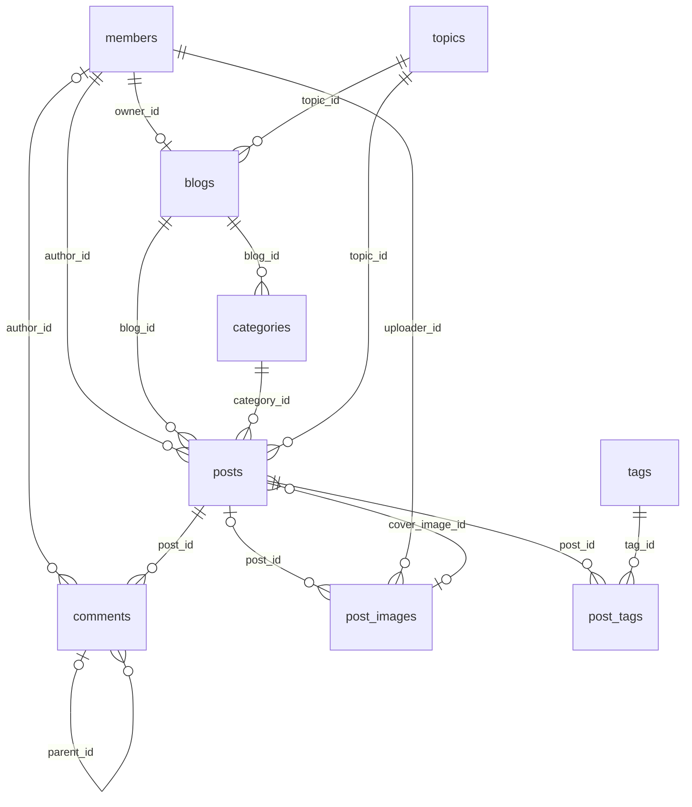
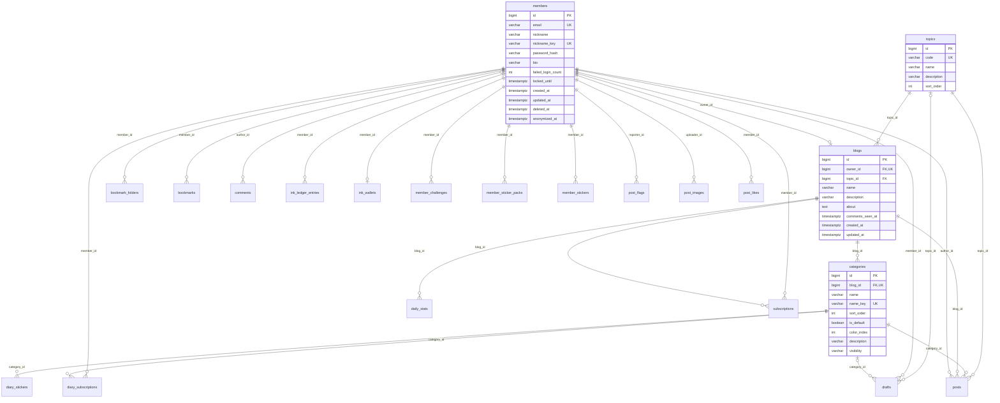
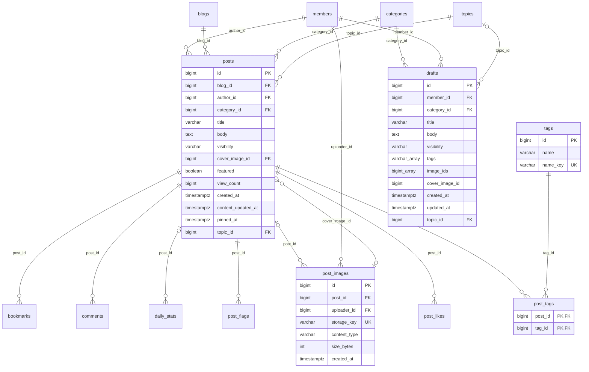
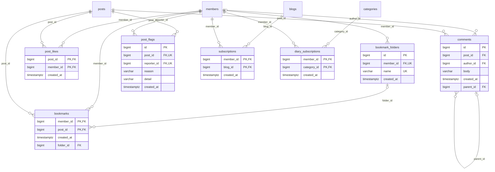
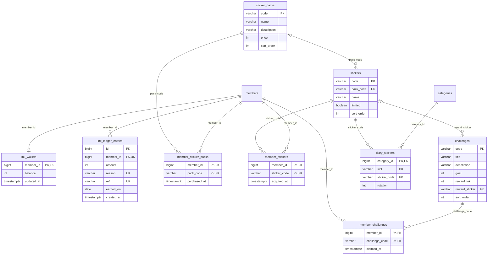
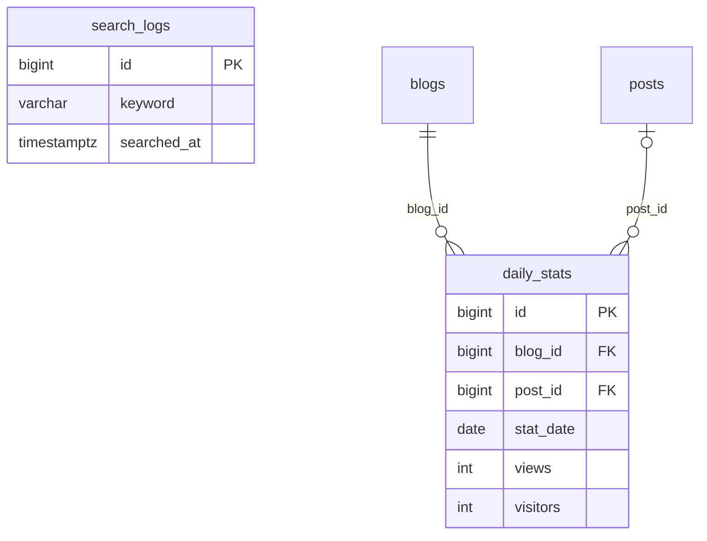

# ERD (데이터베이스 구조)

> 지금 코드(Flyway 마이그레이션 V1~V20)로 만든 PostgreSQL 스키마를 그대로 뽑아 그렸어요. 표 27개, 외래 키 44개예요.
> 마이그레이션 파일이 바뀌면 이 문서도 다시 만들어요. 원본은 `backend/src/main/resources/db/migration/`이에요.

## 읽는 법

- 그림의 선은 외래 키예요. `||--o{`는 "하나에 여러 개", `||--o|`는 "하나에 많아야 하나", 선 왼쪽 `|o`는 비어 있을 수 있는 외래 키예요.
- 그림에는 다른 묶음의 표도 이름만 나와요. 그 표의 칸은 해당 묶음에서 봐요.
- `PK`는 기본 키, `FK`는 외래 키, `UK`는 겹칠 수 없는 칸이에요.
- 각 표가 기능에서 어떻게 쓰이는지는 [기능 설명](../기능/00-목차.md)과 [동작 원리](../원리/00-목차.md)에 있어요.

## 한눈에 (핵심 표만)

## 표 목록

| 묶음 | 표 | 무엇 |
|---|---|---|
| 회원과 블로그 | [`members`](#members) | 회원. 이메일, 비밀번호 해시, 닉네임, 로그인 실패 횟수와 잠금, 탈퇴·익명화 시각 |
| 회원과 블로그 | [`blogs`](#blogs) | 블로그. 회원마다 하나(owner_id UNIQUE) |
| 회원과 블로그 | [`categories`](#categories) | 다이어리. 블로그 안에서 글을 나눠 담는 칸, 공개 범위를 가짐 |
| 회원과 블로그 | [`topics`](#topics) | 분야(9개). 블로그와 글이 하나씩 고름 |
| 글 | [`posts`](#posts) | 글 |
| 글 | [`post_images`](#post_images) | 올린 사진. 파일은 디스크에 있고 여기는 이름표와 형식만 |
| 글 | [`tags`](#tags) | 태그 이름(소문자로 맞춘 name_key로 겹침 막기) |
| 글 | [`post_tags`](#post_tags) | 글과 태그를 잇는 표 |
| 글 | [`drafts`](#drafts) | 임시저장 글 |
| 읽기와 소통 | [`comments`](#comments) | 댓글과 답글(parent_id가 있으면 답글) |
| 읽기와 소통 | [`post_likes`](#post_likes) | 좋아요. 한 사람이 한 글에 한 번 |
| 읽기와 소통 | [`bookmark_folders`](#bookmark_folders) | 책갈피 폴더 |
| 읽기와 소통 | [`bookmarks`](#bookmarks) | 책갈피. 폴더가 없으면 미분류 |
| 읽기와 소통 | [`post_flags`](#post_flags) | 신고. 한 사람이 한 글에 한 번 |
| 읽기와 소통 | [`subscriptions`](#subscriptions) | 블로그 구독 |
| 읽기와 소통 | [`diary_subscriptions`](#diary_subscriptions) | 다이어리 구독 |
| 잉크와 스티커 | [`ink_wallets`](#ink_wallets) | 회원마다 잉크 잔액 |
| 잉크와 스티커 | [`ink_ledger_entries`](#ink_ledger_entries) | 잉크가 들어오고 나간 내역. (회원, 이유, 대상)이 같으면 두 번 주지 않음 |
| 잉크와 스티커 | [`sticker_packs`](#sticker_packs) | 스티커 팩(상점 상품) |
| 잉크와 스티커 | [`stickers`](#stickers) | 스티커 하나하나 |
| 잉크와 스티커 | [`member_sticker_packs`](#member_sticker_packs) | 회원이 산 팩 |
| 잉크와 스티커 | [`member_stickers`](#member_stickers) | 회원이 가진 스티커 |
| 잉크와 스티커 | [`challenges`](#challenges) | 도전과제와 보상 스티커 |
| 잉크와 스티커 | [`member_challenges`](#member_challenges) | 회원이 달성한 도전과제 |
| 잉크와 스티커 | [`diary_stickers`](#diary_stickers) | 다이어리 표지에 붙인 스티커(자리마다 하나) |
| 통계와 검색 | [`daily_stats`](#daily_stats) | 날짜별 조회수·방문자 집계 |
| 통계와 검색 | [`search_logs`](#search_logs) | 검색 기록(인기 검색어 계산용) |

## 회원과 블로그

가입하면 블로그 하나와 기본 다이어리 "일기장"이 생겨요. 다이어리(categories)마다 공개 범위가 있어요.

### members

회원. 이메일, 비밀번호 해시, 닉네임, 로그인 실패 횟수와 잠금, 탈퇴·익명화 시각

| 칸 | 형식 | 비어도 됨 | 기본값 | 키 |
|---|---|---|---|---|
| `id` | bigint |  |  | PK |
| `email` | character varying(254) |  |  |  |
| `nickname` | character varying(10) |  |  |  |
| `nickname_key` | character varying(10) |  |  |  |
| `password_hash` | character varying(72) |  |  |  |
| `bio` | character varying(100) |  | `''::character varying` |  |
| `failed_login_count` | integer |  | `0` |  |
| `locked_until` | timestamp with time zone | 예 |  |  |
| `created_at` | timestamp with time zone |  |  |  |
| `updated_at` | timestamp with time zone |  |  |  |
| `deleted_at` | timestamp with time zone | 예 |  |  |
| `anonymized_at` | timestamp with time zone | 예 |  |  |

겹치면 안 되는 조합: (`email`), (`nickname_key`)

### blogs

블로그. 회원마다 하나(owner_id UNIQUE)

| 칸 | 형식 | 비어도 됨 | 기본값 | 키 |
|---|---|---|---|---|
| `id` | bigint |  |  | PK |
| `owner_id` | bigint |  |  | FK → `members.id` (같이 지움) |
| `topic_id` | bigint |  |  | FK → `topics.id` (지우기 막음) |
| `name` | character varying(30) |  |  |  |
| `description` | character varying(200) |  | `''::character varying` |  |
| `about` | text |  | `''::text` |  |
| `comments_seen_at` | timestamp with time zone |  |  |  |
| `created_at` | timestamp with time zone |  |  |  |
| `updated_at` | timestamp with time zone |  |  |  |

겹치면 안 되는 조합: (`owner_id`)

### categories

다이어리. 블로그 안에서 글을 나눠 담는 칸, 공개 범위를 가짐

| 칸 | 형식 | 비어도 됨 | 기본값 | 키 |
|---|---|---|---|---|
| `id` | bigint |  |  | PK |
| `blog_id` | bigint |  |  | FK → `blogs.id` (같이 지움) |
| `name` | character varying(20) |  |  |  |
| `name_key` | character varying(20) |  |  |  |
| `sort_order` | integer |  |  |  |
| `is_default` | boolean |  | `false` |  |
| `color_index` | integer |  |  |  |
| `description` | character varying(100) |  | `''::character varying` |  |
| `visibility` | character varying(12) |  | `'PUBLIC'::character varying` |  |

겹치면 안 되는 조합: (`blog_id`, `name_key`)

### topics

분야(9개). 블로그와 글이 하나씩 고름

| 칸 | 형식 | 비어도 됨 | 기본값 | 키 |
|---|---|---|---|---|
| `id` | bigint |  |  | PK |
| `code` | character varying(20) |  |  |  |
| `name` | character varying(20) |  |  |  |
| `description` | character varying(100) |  |  |  |
| `sort_order` | integer |  |  |  |

겹치면 안 되는 조합: (`code`)

## 글

글은 블로그와 다이어리에 속하고, 분야와 태그를 가져요. 사진은 따로 저장하고 글과 이어요.

### posts

글

| 칸 | 형식 | 비어도 됨 | 기본값 | 키 |
|---|---|---|---|---|
| `id` | bigint |  |  | PK |
| `blog_id` | bigint |  |  | FK → `blogs.id` (같이 지움) |
| `author_id` | bigint |  |  | FK → `members.id` (지우기 막음) |
| `category_id` | bigint |  |  | FK → `categories.id` (지우기 막음) |
| `title` | character varying(100) |  |  |  |
| `body` | text |  |  |  |
| `visibility` | character varying(12) |  | `'PUBLIC'::character varying` |  |
| `cover_image_id` | bigint | 예 |  | FK → `post_images.id` (비움) |
| `featured` | boolean |  | `false` |  |
| `view_count` | bigint |  | `0` |  |
| `created_at` | timestamp with time zone |  |  |  |
| `content_updated_at` | timestamp with time zone | 예 |  |  |
| `pinned_at` | timestamp with time zone | 예 |  |  |
| `topic_id` | bigint |  |  | FK → `topics.id` (지우기 막음) |

### post_images

올린 사진. 파일은 디스크에 있고 여기는 이름표와 형식만

| 칸 | 형식 | 비어도 됨 | 기본값 | 키 |
|---|---|---|---|---|
| `id` | bigint |  |  | PK |
| `post_id` | bigint | 예 |  | FK → `posts.id` (같이 지움) |
| `uploader_id` | bigint |  |  | FK → `members.id` (같이 지움) |
| `storage_key` | character varying(200) |  |  |  |
| `content_type` | character varying(20) |  |  |  |
| `size_bytes` | integer |  |  |  |
| `created_at` | timestamp with time zone |  |  |  |

겹치면 안 되는 조합: (`storage_key`)

### tags

태그 이름(소문자로 맞춘 name_key로 겹침 막기)

| 칸 | 형식 | 비어도 됨 | 기본값 | 키 |
|---|---|---|---|---|
| `id` | bigint |  |  | PK |
| `name` | character varying(15) |  |  |  |
| `name_key` | character varying(15) |  |  |  |

겹치면 안 되는 조합: (`name_key`)

### post_tags

글과 태그를 잇는 표

| 칸 | 형식 | 비어도 됨 | 기본값 | 키 |
|---|---|---|---|---|
| `post_id` | bigint |  |  | PK, FK → `posts.id` (같이 지움) |
| `tag_id` | bigint |  |  | PK, FK → `tags.id` (지우기 막음) |

기본 키가 (post_id, tag_id) 조합이라 같은 짝은 한 번만 들어가요.

### drafts

임시저장 글

| 칸 | 형식 | 비어도 됨 | 기본값 | 키 |
|---|---|---|---|---|
| `id` | bigint |  |  | PK |
| `member_id` | bigint |  |  | FK → `members.id` (같이 지움) |
| `category_id` | bigint | 예 |  | FK → `categories.id` (비움) |
| `title` | character varying(100) |  | `''::character varying` |  |
| `body` | text |  | `''::text` |  |
| `visibility` | character varying(12) |  | `'PUBLIC'::character varying` |  |
| `tags` | varchar[] |  | `'{}'::character varying[]` |  |
| `image_ids` | bigint[] |  | `'{}'::bigint[]` |  |
| `cover_image_id` | bigint | 예 |  |  |
| `created_at` | timestamp with time zone |  |  |  |
| `updated_at` | timestamp with time zone |  |  |  |
| `topic_id` | bigint | 예 |  | FK → `topics.id` (비움) |

## 읽기와 소통

댓글, 좋아요, 책갈피, 신고, 구독은 모두 "회원 하나와 글(또는 블로그·다이어리) 하나"를 잇는 표예요.

### comments

댓글과 답글(parent_id가 있으면 답글)

| 칸 | 형식 | 비어도 됨 | 기본값 | 키 |
|---|---|---|---|---|
| `id` | bigint |  |  | PK |
| `post_id` | bigint |  |  | FK → `posts.id` (같이 지움) |
| `author_id` | bigint | 예 |  | FK → `members.id` (비움) |
| `body` | character varying(500) |  |  |  |
| `created_at` | timestamp with time zone |  |  |  |
| `parent_id` | bigint | 예 |  | FK → `comments.id` (같이 지움) |

### post_likes

좋아요. 한 사람이 한 글에 한 번

| 칸 | 형식 | 비어도 됨 | 기본값 | 키 |
|---|---|---|---|---|
| `post_id` | bigint |  |  | PK, FK → `posts.id` (같이 지움) |
| `member_id` | bigint |  |  | PK, FK → `members.id` (같이 지움) |
| `created_at` | timestamp with time zone |  |  |  |

기본 키가 (post_id, member_id) 조합이라 같은 짝은 한 번만 들어가요.

### bookmark_folders

책갈피 폴더

| 칸 | 형식 | 비어도 됨 | 기본값 | 키 |
|---|---|---|---|---|
| `id` | bigint |  |  | PK |
| `member_id` | bigint |  |  | FK → `members.id` (같이 지움) |
| `name` | character varying(20) |  |  |  |
| `created_at` | timestamp with time zone |  |  |  |

겹치면 안 되는 조합: (`member_id`, `name`)

### bookmarks

책갈피. 폴더가 없으면 미분류

| 칸 | 형식 | 비어도 됨 | 기본값 | 키 |
|---|---|---|---|---|
| `member_id` | bigint |  |  | PK, FK → `members.id` (같이 지움) |
| `post_id` | bigint |  |  | PK, FK → `posts.id` (같이 지움) |
| `created_at` | timestamp with time zone |  |  |  |
| `folder_id` | bigint | 예 |  | FK → `bookmark_folders.id` (비움) |

기본 키가 (member_id, post_id) 조합이라 같은 짝은 한 번만 들어가요.

### post_flags

신고. 한 사람이 한 글에 한 번

| 칸 | 형식 | 비어도 됨 | 기본값 | 키 |
|---|---|---|---|---|
| `id` | bigint |  |  | PK |
| `post_id` | bigint |  |  | FK → `posts.id` (같이 지움) |
| `reporter_id` | bigint |  |  | FK → `members.id` (같이 지움) |
| `reason` | character varying(20) |  |  |  |
| `detail` | character varying(200) |  | `''::character varying` |  |
| `created_at` | timestamp with time zone |  |  |  |

겹치면 안 되는 조합: (`post_id`, `reporter_id`)

### subscriptions

블로그 구독

| 칸 | 형식 | 비어도 됨 | 기본값 | 키 |
|---|---|---|---|---|
| `member_id` | bigint |  |  | PK, FK → `members.id` (같이 지움) |
| `blog_id` | bigint |  |  | PK, FK → `blogs.id` (같이 지움) |
| `created_at` | timestamp with time zone |  |  |  |

기본 키가 (member_id, blog_id) 조합이라 같은 짝은 한 번만 들어가요.

### diary_subscriptions

다이어리 구독

| 칸 | 형식 | 비어도 됨 | 기본값 | 키 |
|---|---|---|---|---|
| `member_id` | bigint |  |  | PK, FK → `members.id` (같이 지움) |
| `category_id` | bigint |  |  | PK, FK → `categories.id` (같이 지움) |
| `created_at` | timestamp with time zone |  |  |  |

기본 키가 (member_id, category_id) 조합이라 같은 짝은 한 번만 들어가요.

## 잉크와 스티커

잉크는 지갑(잔액)과 내역 두 표로 관리해요. 스티커는 팩, 스티커, 회원이 가진 것, 다이어리에 붙인 것으로 나뉘어요.

### ink_wallets

회원마다 잉크 잔액

| 칸 | 형식 | 비어도 됨 | 기본값 | 키 |
|---|---|---|---|---|
| `member_id` | bigint |  |  | PK, FK → `members.id` (같이 지움) |
| `balance` | integer |  | `0` |  |
| `updated_at` | timestamp with time zone |  |  |  |

### ink_ledger_entries

잉크가 들어오고 나간 내역. (회원, 이유, 대상)이 같으면 두 번 주지 않음

| 칸 | 형식 | 비어도 됨 | 기본값 | 키 |
|---|---|---|---|---|
| `id` | bigint |  |  | PK |
| `member_id` | bigint |  |  | FK → `members.id` (같이 지움) |
| `amount` | integer |  |  |  |
| `reason` | character varying(20) |  |  |  |
| `ref` | character varying(60) |  |  |  |
| `earned_on` | date |  |  |  |
| `created_at` | timestamp with time zone |  |  |  |

겹치면 안 되는 조합: (`member_id`, `reason`, `ref`)

### sticker_packs

스티커 팩(상점 상품)

| 칸 | 형식 | 비어도 됨 | 기본값 | 키 |
|---|---|---|---|---|
| `code` | character varying(30) |  |  | PK |
| `name` | character varying(20) |  |  |  |
| `description` | character varying(100) |  |  |  |
| `price` | integer |  |  |  |
| `sort_order` | integer |  |  |  |

### stickers

스티커 하나하나

| 칸 | 형식 | 비어도 됨 | 기본값 | 키 |
|---|---|---|---|---|
| `code` | character varying(30) |  |  | PK |
| `pack_code` | character varying(30) | 예 |  | FK → `sticker_packs.code` (지우기 막음) |
| `name` | character varying(20) |  |  |  |
| `limited` | boolean |  | `false` |  |
| `sort_order` | integer |  |  |  |

### member_sticker_packs

회원이 산 팩

| 칸 | 형식 | 비어도 됨 | 기본값 | 키 |
|---|---|---|---|---|
| `member_id` | bigint |  |  | PK, FK → `members.id` (같이 지움) |
| `pack_code` | character varying(30) |  |  | PK, FK → `sticker_packs.code` (지우기 막음) |
| `purchased_at` | timestamp with time zone |  |  |  |

기본 키가 (member_id, pack_code) 조합이라 같은 짝은 한 번만 들어가요.

### member_stickers

회원이 가진 스티커

| 칸 | 형식 | 비어도 됨 | 기본값 | 키 |
|---|---|---|---|---|
| `member_id` | bigint |  |  | PK, FK → `members.id` (같이 지움) |
| `sticker_code` | character varying(30) |  |  | PK, FK → `stickers.code` (지우기 막음) |
| `acquired_at` | timestamp with time zone |  |  |  |

기본 키가 (member_id, sticker_code) 조합이라 같은 짝은 한 번만 들어가요.

### challenges

도전과제와 보상 스티커

| 칸 | 형식 | 비어도 됨 | 기본값 | 키 |
|---|---|---|---|---|
| `code` | character varying(30) |  |  | PK |
| `title` | character varying(30) |  |  |  |
| `description` | character varying(100) |  |  |  |
| `goal` | integer |  |  |  |
| `reward_ink` | integer |  |  |  |
| `reward_sticker` | character varying(30) | 예 |  | FK → `stickers.code` (지우기 막음) |
| `sort_order` | integer |  |  |  |

### member_challenges

회원이 달성한 도전과제

| 칸 | 형식 | 비어도 됨 | 기본값 | 키 |
|---|---|---|---|---|
| `member_id` | bigint |  |  | PK, FK → `members.id` (같이 지움) |
| `challenge_code` | character varying(30) |  |  | PK, FK → `challenges.code` (지우기 막음) |
| `claimed_at` | timestamp with time zone |  |  |  |

기본 키가 (member_id, challenge_code) 조합이라 같은 짝은 한 번만 들어가요.

### diary_stickers

다이어리 표지에 붙인 스티커(자리마다 하나)

| 칸 | 형식 | 비어도 됨 | 기본값 | 키 |
|---|---|---|---|---|
| `category_id` | bigint |  |  | PK, FK → `categories.id` (같이 지움) |
| `slot` | character varying(2) |  |  | PK |
| `sticker_code` | character varying(30) |  |  | FK → `stickers.code` (지우기 막음) |
| `rotation` | integer |  | `0` |  |

기본 키가 (category_id, slot) 조합이라 같은 짝은 한 번만 들어가요.

## 통계와 검색

다른 표와 거의 이어지지 않는 기록용 표예요.

### daily_stats

날짜별 조회수·방문자 집계

| 칸 | 형식 | 비어도 됨 | 기본값 | 키 |
|---|---|---|---|---|
| `id` | bigint |  |  | PK |
| `blog_id` | bigint |  |  | FK → `blogs.id` (같이 지움) |
| `post_id` | bigint | 예 |  | FK → `posts.id` (같이 지움) |
| `stat_date` | date |  |  |  |
| `views` | integer |  | `0` |  |
| `visitors` | integer |  | `0` |  |

### search_logs

검색 기록(인기 검색어 계산용)

| 칸 | 형식 | 비어도 됨 | 기본값 | 키 |
|---|---|---|---|---|
| `id` | bigint |  |  | PK |
| `keyword` | character varying(50) |  |  |  |
| `searched_at` | timestamp with time zone |  |  |  |
